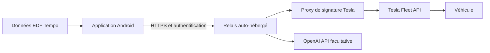

# Tesla Tempo AI

**Planifier sa recharge à domicile selon EDF Tempo, ses déplacements et son objectif de batterie.**

[](#état-du-projet)
[](#architecture-prévue)
[](LICENSE)

Tesla Tempo AI est un projet d'application Android native pour optimiser la recharge domestique d'une Tesla. Il combine les tarifs EDF Tempo, la disponibilité du véhicule et un calendrier de mobilité. Un assistant IA facultatif explique les plans et aide à les simuler ; le calcul et les contrôles restent déterministes.

## État du projet

**Le relais Docker V1 (`0.1.0`) est disponible dans ce dépôt.** Il fonctionne en mode démonstration et implémente OAuth et les lectures Tesla, testés avec un serveur simulé. Il fournit aussi le cahier des charges et l’audit des API.

L’image se construit localement ; aucune image n’est encore publiée dans un registre. Le [prototype Android 0.4.0](apps/android/README.md) est disponible : tableau de bord, démonstration hors connexion et connexion au relais en lecture seule, thème sombre, simulation Tempo/F20, couleurs et tarifs publiés, profil et calendrier personnels sauvegardés, historique local des simulations. Les commandes signées et l’intégration sur véhicule réel restent à développer ou valider. Les fonctionnalités ci-dessous décrivent la cible du projet.

### Essayer le relais

Avec Docker Compose, Python 3 et OpenSSL, depuis un compte non-root :

```bash
python3 scripts/init-local.py
docker compose up -d --build --wait
python3 scripts/relayctl.py status
```

Le mode par défaut utilise un véhicule fictif et ne contacte pas Tesla. Voir le [guide du relais V1](docs/relay-v1.md) pour HTTPS, TrueNAS SCALE et la connexion réelle en lecture seule.

## La recharge que l'on veut construire

- **Objectif de 80 % par défaut** : l'heure de départ est indicative et ne déclenche pas un arrêt de la recharge.
- **Priorité aux tarifs économiques** : complément en heures pleines possible, même en jour rouge, avec surcoût affiché.
- **Courant initial limité à 10 A** : respect des contraintes de l'installation et des réglages manuels.
- **Un plan à valider** : après réception de la couleur Tempo du lendemain, appliquer, modifier ou ignorer la proposition.
- **Un programme exécuté par la voiture** : privilégier les fonctions natives Tesla pour continuer sans dépendre du téléphone. Leur comportement reste à tester.

### Fonctionnalités prévues

| Domaine | Périmètre |
| --- | --- |
| Tableau de bord | Batterie, branchement, Tempo, plan et coût estimé |
| Mobilité | Bureau, télétravail, week-ends, vacances et exceptions |
| Historique | Sessions domestiques et Supercharger, coûts et qualité des données |
| Statistiques | kWh, dépenses, répartition HP/HC et exports CSV/JSON |
| Assistant facultatif | Explications et simulations ; actions soumises à validation |
| Linky, dans un second temps | Statistiques différées du foyer, sans pilotage de recharge |

La planification concerne uniquement la recharge à domicile. Les Superchargers sont utilisés pour l'historique et les statistiques.

## Architecture prévue



L'application utilisera Kotlin, Jetpack Compose et Material 3, avec un stockage local et un moteur de planification déterministe. Le relais protégera les secrets et prendra en charge l'authentification Tesla et les commandes signées.

### Un relais hébergé par chaque utilisateur

Chaque utilisateur déploiera sa propre instance sur un NAS compatible, une VM Linux ou un autre hébergement adapté, avec ses propres comptes et secrets. TrueNAS est le premier environnement envisagé.

Le projet fournit le Dockerfile public et un exemple Docker Compose pour construire une image sans secrets. L'utilisateur sera responsable du domaine, de l'accès HTTPS, de son inscription Tesla Developer, de la maintenance et des coûts des API. L'adresse du relais sera configurable dans Android.

La clé publique Tesla doit être accessible au chemin HTTPS prévu par Tesla. Les secrets et le proxy de signature restent protégés. Voir le [guide d'auto-hébergement](docs/self-hosting.md).

## Organisation du dépôt

```text
apps/android/       Application Android Kotlin/Compose
services/relay/     Relais Python, tests, dépendances et Dockerfile
scripts/            Préparation et contrôle de l’instance locale
deploy/             Exemples de configuration HTTPS et hébergement
docs/               Cahier des charges, faisabilité et guides
.github/            Tests automatisés et modèles de contribution
compose.yaml        Démarrage du relais depuis la racine
```

Chaque composant regroupe son code et ses tests. Les secrets et les données d’instance restent hors de Git. La [carte du dépôt](docs/repository.md) décrit les conventions et les commandes.

## Documentation

| Document | Contenu |
| --- | --- |
| [Cahier des charges](docs/specification.md) | Règles métier, fonctionnalités et critères d'acceptation |
| [Audit de faisabilité](docs/feasibility.md) | Sources officielles, contraintes et points restant à tester |
| [Historique des simulations](docs/simulation-history.md) | Enregistrement local, consultation et suppression |
| [Tempo et profil personnel](docs/tempo-personal.md) | Source des données, cache, paramètres et calendrier |
| [Démarches Tesla Developer](docs/tesla-developer.md) | Application, autorisations, clés, facturation et connexion au compte |
| [Installation TrueNAS](docs/installation-truenas.md) | Installation depuis un autre poste, reprise et restauration |
| [Relais Docker V1](docs/relay-v1.md) | Démarrage, configuration HTTPS, OAuth et exploitation |
| [Auto-hébergement](docs/self-hosting.md) | Responsabilités, secrets, HTTPS et déploiement prévu |
| [Contribuer](CONTRIBUTING.md) | Proposer une évolution ou préparer une contribution |

## Feuille de route

- [x] Consolider les besoins et les règles de recharge.
- [x] Réaliser l'audit documentaire initial Tesla/OpenAI.
- [x] Retenir le modèle de relais auto-hébergé.
- [x] Initialiser le projet Android, la démonstration véhicule et le client du relais.
- [x] Intégrer une source Tempo publiée avec cache daté et conserver une démonstration fictive séparée.
- [x] Développer et tester le moteur Tempo/F20 et les coûts sur des scénarios fictifs.
- [x] Relier un calcul personnel aux données Tempo, aux tarifs publiés et aux profils de mobilité sauvegardés.
- [x] Conserver les simulations localement avec leurs hypothèses et tarifs.
- [ ] Intégrer la consommation des trajets et l’historique des recharges réelles.
- [ ] Construire les écrans sur données simulées.
- [x] Fournir une V1 du relais en lecture seule, son Dockerfile et le déploiement Compose.
- [ ] Intégrer le proxy Tesla de signature et la validation des commandes.
- [ ] Valider OAuth et les lectures sur un compte Tesla réel.
- [ ] Tester les commandes signées et la programmation autonome.
- [ ] Intégrer l'assistant facultatif, puis finaliser exports et APK.

## Participer

Les retours sur les besoins, les cas limites de recharge et l'auto-hébergement sont les bienvenus dans les [issues](https://github.com/wthomare/TeslaTempo/issues). Consulter le [guide de contribution](CONTRIBUTING.md) avant de proposer une modification.

Ne publier aucun jeton, clé privée, mot de passe, VIN ou emplacement précis dans les issues et les journaux joints.

## Licence

Le projet est distribué sous [licence Apache 2.0](LICENSE). Projet indépendant, non affilié à Tesla, EDF ou OpenAI.
